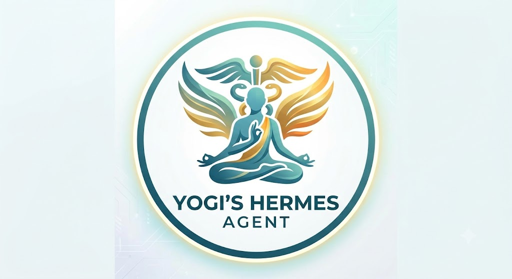

**Personal AI Agent** is an intelligent assistant bot designed to aggregate calendar events and manage your schedule effortlessly across platforms.

By connecting with your calendars and communication channels, Personal AI Agent keeps track of meetings, deadlines, reminders, and daily agendas—helping you plan ahead, avoid scheduling conflicts, and prioritize your time.

## Key Features

- **Calendar Aggregation**: Centralizes events, schedules, and agendas from multiple calendar sources into a single unified timeline.
- **Automated Event Management**: Create, update, reschedule, or inspect calendar events using natural language prompts or chat commands.
- **Smart Scheduling & Reminders**: Proactively alerts you to upcoming events, prevents conflicts, and optimizes meeting slots.
- **Privacy-First**: Built with security and privacy in mind, ensuring your schedule and personal agenda data remain under your control.

## Documentation & Legal

- [Terms & Conditions][tnc]
- [Privacy Policy][privacy-policy]

[privacy-policy]: privacy
[tnc]: tnc
[icon]: app-icon.jpg
